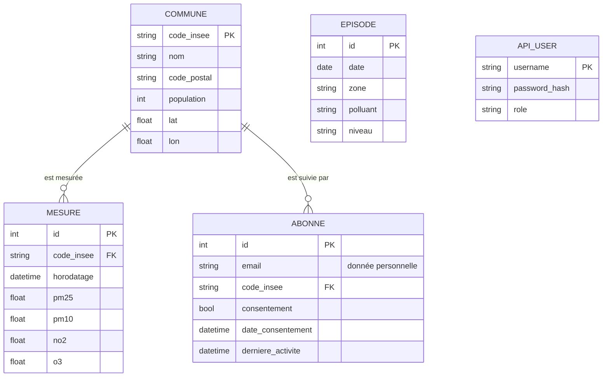

# C4 — Modèle de données

## Choix du SGBD

| Critère | PostgreSQL (retenu) | SQLite | MongoDB |
|---|---|---|---|
| Données relationnelles (commune → mesures) | Oui, clés étrangères | Oui | Pas naturel |
| Séries temporelles, fonctions de fenêtre | Oui | Limité | Agrégations possibles |
| Multi-utilisateurs, droits, rôles | Oui | Non | Oui |
| Déploiement Docker | Image officielle | Fichier local | Image officielle |

PostgreSQL est retenu pour les jointures, les fonctions de fenêtre (requête Q3) et la gestion des rôles. SQLite sert uniquement aux tests automatisés.

## MCD



## MPD — contraintes notables

- `mesure` : contrainte d'unicité `(code_insee, horodatage)` → l'import est idempotent (relancer la collecte ne crée pas de doublons).
- Index sur `mesure.code_insee` et `mesure.horodatage`, plus l'index composite créé dans `sql/queries.sql` (Q6).
- `abonne.email` unique ; aucun mot de passe stocké pour les abonnés.
- `api_user.password_hash` : PBKDF2-SHA256 salé, 200 000 itérations (`src/security.py`).

Le MPD est défini en code dans `src/db/models.py` (source de vérité unique).

## Procédure d'installation

```bash
cp .env.example .env              # puis remplir les mots de passe
docker compose up -d db
python -m src.data.collect --source all
python -m src.data.clean
DATABASE_URL=postgresql+psycopg2://airdata:<mdp>@localhost:5432/airdata python -m src.db.import_data
```
